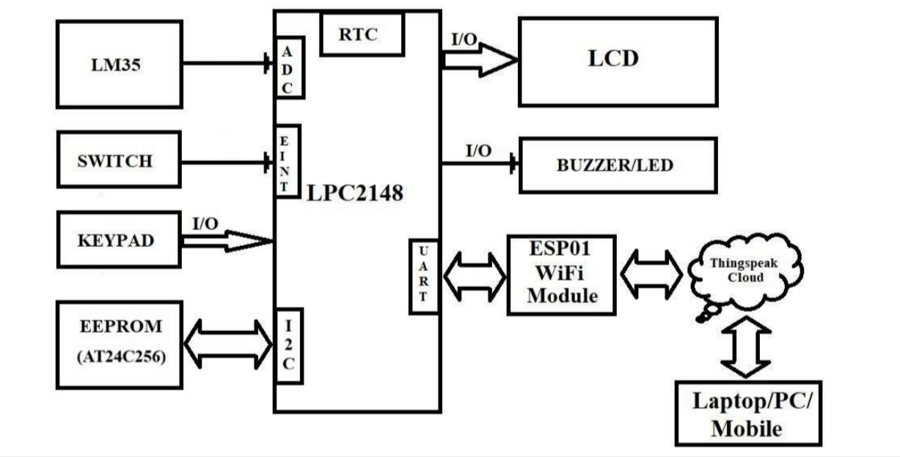
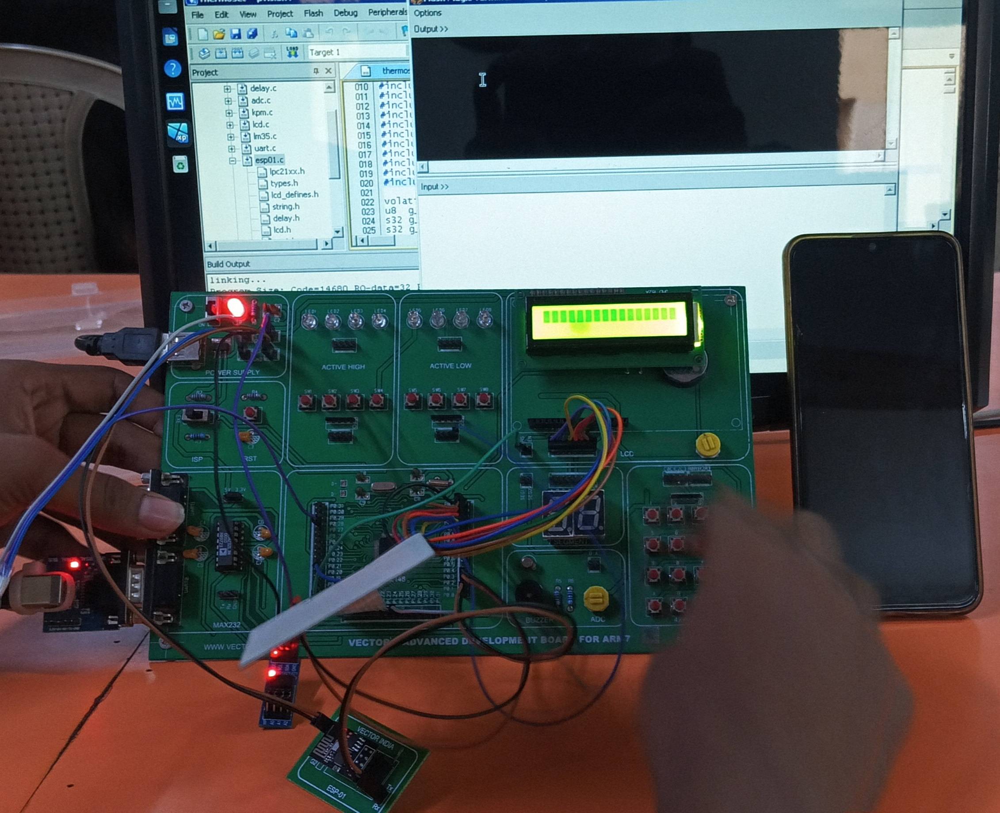
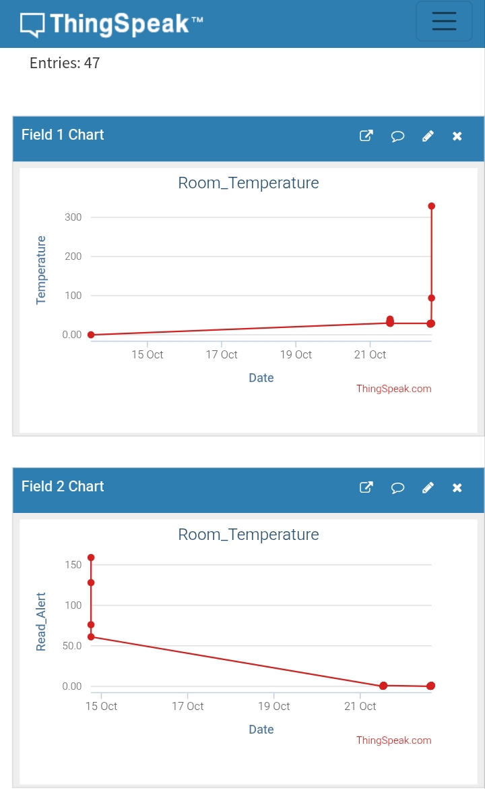
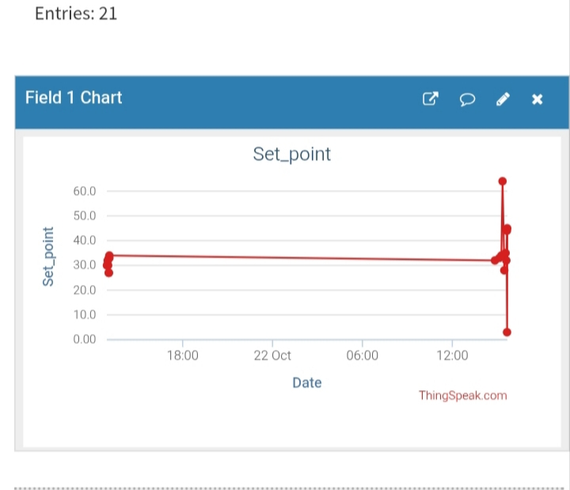

🌡️ ThermoSet — ARM-Based IoT Temperature Monitoring and Control System

An embedded systems and IoT project for real-time temperature monitoring, configurable temperature set-points, automatic alerts, and remote monitoring using ThingSpeak.

ThermoSet is an ARM-based temperature monitoring and alert system developed using embedded C. It combines temperature sensing, an LCD interface, a real-time clock (RTC), EEPROM-based data storage, a keypad, and an ESP8266 ESP-01 Wi-Fi module to provide local monitoring and cloud connectivity.

The system continuously measures room temperature, compares it against a configurable set-point, and activates an audible and visual alert when the temperature exceeds the threshold. It also supports changing the set-point locally or remotely through ThingSpeak.

---

📌 Table of Contents

- "Project Overview" (#-project-overview)
- "Project Objectives" (#-project-objectives)
- "Key Features" (#-key-features)
- "System Architecture" (#-system-architecture)
- "Block Diagram" (#-block-diagram)
- "Hardware Components" (#-hardware-components)
- "Software and Technologies" (#-software-and-technologies)
- "Working Principle" (#-working-principle)
- "Temperature Alert Mechanism" (#-temperature-alert-mechanism)
- "Cloud Integration with ThingSpeak" (#-cloud-integration-with-thingspeak)
- "Project Directory Structure" (#-project-directory-structure)
- "Hardware Connections" (#-hardware-connections)
- "Configuration and Setup" (#-configuration-and-setup)
- "User Interface and Controls" (#-user-interface-and-controls)
- "Project Images" (#-project-images)
- "Applications" (#-applications)
- "Limitations and Future Improvements" (#-limitations-and-future-improvements)
- "Learning Outcomes" (#-learning-outcomes)

---

📖 Project Overview

Temperature monitoring is an important requirement in environments where excessive heat can affect equipment, materials, and operating conditions.

Traditional temperature monitoring systems may require users to remain physically present to observe the temperature and respond to abnormal conditions.

ThermoSet addresses this requirement by combining embedded hardware with IoT-based monitoring and remote set-point management.

The system uses an LM35 temperature sensor to measure temperature and an ARM7-based LPC21xx microcontroller to process the sensor reading. The current temperature is displayed on an LCD and compared with a configurable set-point.

When the measured temperature exceeds the set-point, the system activates a buzzer and an alert LED. The buzzer can be silenced locally while the alert LED continues to indicate the alarm condition.

An ESP8266 ESP-01 module provides Wi-Fi connectivity for communication with the ThingSpeak IoT platform. Temperature and alert information can be uploaded to the cloud, while a remotely configured set-point can be retrieved and applied by the controller.

The AT24C256-compatible I²C EEPROM interface is used by the project’s EEPROM routines to store the current and previous set-point values so that configuration can be retained across power cycles.

The system also incorporates an RTC and keypad-based configuration menu for local time, date, and set-point management.

Project at a Glance

Parameter| Description
Project Name| ThermoSet
Project Domain| Embedded Systems and Internet of Things
Controller Family| ARM7 / LPC21xx
Programming Language| Embedded C
Temperature Sensor| LM35
Wireless Communication| ESP8266 ESP-01
Cloud Platform| ThingSpeak
Persistent Storage| I²C EEPROM
Display| Character LCD
User Input| Keypad
Timekeeping| RTC
Alert Mechanism| Buzzer and LED
Cloud Communication| ESP8266 AT commands over UART

---

🎯 Project Objectives

The main objectives of this project are:

1. To measure room temperature using an LM35 temperature sensor.
2. To process and display temperature readings using an ARM-based microcontroller.
3. To provide a configurable temperature set-point.
4. To generate audible and visual alerts when the measured temperature exceeds the configured threshold.
5. To allow local set-point modification through a keypad.
6. To store the current and previous set-point values in external EEPROM.
7. To enable Wi-Fi connectivity using the ESP8266 ESP-01 module.
8. To upload temperature and alert information to ThingSpeak.
9. To retrieve a remotely configured set-point from ThingSpeak.
10. To provide RTC-based timekeeping and local date/time configuration.

---

✨ Key Features

🌡️ 1. Real-Time Temperature Monitoring

The LM35 temperature sensor provides an analog signal proportional to the measured temperature.

The microcontroller reads the sensor through its ADC interface and calculates the temperature for display and threshold comparison.

🚨 2. Automatic Temperature Alerts

The measured temperature is compared with the configured set-point.

When:

"Temperature > Set-point"

the system enters an alert state and activates the buzzer and alert LED.

When the temperature returns to or below the set-point, the alert condition is cleared.

🔇 3. Local Buzzer Silencing

While an alert is active, a keypad press can silence the buzzer.

The alert LED remains active while the temperature alert condition persists, allowing the user to identify the condition even after silencing the audible alarm.

⌨️ 4. Configurable Temperature Set-Point

The set-point can be changed using the keypad-based configuration menu.

The firmware accepts values from 1 to 150, with a default set-point of 35 when the stored current set-point is invalid or blank.

These are firmware configuration limits, not a claim that the complete sensor and hardware system has been calibrated across that entire temperature range.

💾 5. EEPROM-Based Storage

The project uses an I²C EEPROM interface to store:

- Current temperature set-point
- Previous temperature set-point

The current set-point is restored during startup, subject to the firmware's validity checks.

🌐 6. IoT Connectivity

The ESP8266 ESP-01 module connects to a Wi-Fi network and communicates with ThingSpeak using AT commands.

The firmware uses TCP communication to send HTTP requests to ThingSpeak.

☁️ 7. Remote Set-Point Management

The microcontroller periodically checks ThingSpeak for a remotely configured set-point.

When a valid, different set-point is received, the controller updates its current and previous set-point values and saves them to EEPROM.

This enables remote threshold configuration without requiring the user to change the set-point through the local keypad.

🕒 8. Real-Time Clock

The RTC provides timekeeping for the system.

The firmware displays the current time and includes menu options to configure the time and date.

The RTC is also used to schedule periodic cloud operations.

📟 9. LCD-Based Status Information

The LCD provides information about:

- Current temperature
- Configured set-point
- Current time
- Temperature alert status
- Wi-Fi connection status
- Cloud communication status
- Set-point configuration
- Date and time settings

🔌 10. Local Operation During Wi-Fi Failure

The firmware is designed to continue local temperature monitoring and alert operation even if Wi-Fi initialization fails.

Cloud monitoring and remote set-point updates require a working Wi-Fi connection.

---

🏗️ System Architecture

The project is divided into sensing, processing, user interaction, storage, alert, and communication subsystems.

                 ┌──────────────────────┐
                 │     LM35 Sensor      │
                 │  Temperature Input   │
                 └──────────┬───────────┘
                            │ Analog Signal
                            ▼
                 ┌──────────────────────┐
                 │     ADC Interface    │
                 └──────────┬───────────┘
                            │
                            ▼
              ┌────────────────────────────┐
              │                            │
              │   ARM7 LPC21xx Controller  │
              │                            │
              │ Temperature Processing     │
              │ Set-Point Comparison       │
              │ Alert Management           │
              │ RTC and Keypad Handling   │
              │ EEPROM Management          │
              │ Wi-Fi Communication        │
              │                            │
              └───┬────┬────┬────┬────┬────┘
                  │    │    │    │    │
          ┌───────┘    │    │    │    └─────────┐
          ▼            ▼    ▼    ▼              ▼
       ┌──────┐   ┌──────┐ ┌──────┐ ┌──────┐ ┌────────┐
       │ LCD  │   │Keypad│ │ RTC  │ │EEPROM│ │ESP-01  │
       └──────┘   └──────┘ └──────┘ └──────┘ └───┬────┘
                                                  │ Wi-Fi
                                                  ▼
                                         ┌────────────────┐
                                         │   ThingSpeak   │
                                         │   IoT Cloud     │
                                         └────────────────┘

                 ARM Controller Outputs
                         │
                  ┌──────┴──────┐
                  ▼             ▼
              ┌────────┐    ┌────────┐
              │ Buzzer │    │Alert LED│
              └────────┘    └────────┘

---

📊 Block Diagram

The original project block diagram is available in the repository.

---

🔩 Hardware Components

The following components are used or referenced by the project firmware.

Component| Purpose
ARM7 LPC21xx microcontroller| Main controller and processing unit
LM35 temperature sensor| Analog temperature measurement
ESP8266 ESP-01 module| Wi-Fi connectivity and cloud communication
AT24C256-compatible I²C EEPROM| Persistent set-point storage
Character LCD| Temperature, time, and system status display
Keypad| User input and configuration
RTC| Timekeeping and date/time configuration
Buzzer| Audible temperature alert
LED| Visual temperature alert
Power supply| Supplies the controller and connected modules
Supporting components| Wiring, resistors, and interface circuitry as required

---

💻 Software and Technologies

Programming Language

- Embedded C

Microcontroller Peripherals and Interfaces

- ADC for analog temperature acquisition
- UART for ESP8266 communication
- I²C for EEPROM communication
- LCD interface for displaying system information
- Keypad scanning for user input
- RTC interface for time and date operations
- External interrupt handling for the local configuration menu
- GPIO control for the buzzer and alert LED

IoT and Cloud

- ESP8266 ESP-01 AT command interface
- Wi-Fi network connectivity
- TCP communication
- HTTP requests
- ThingSpeak channel fields and API keys

Firmware Organization

The project uses separate source and header files to organize peripheral drivers, communication routines, and application logic.

This modular approach makes the firmware easier to understand, maintain, and extend.

---

⚙️ Working Principle

The system operates through the following sequence.

Step 1: System Initialization

During startup, the firmware initializes the UART, I²C interface, LCD, keypad, external interrupt configuration, and RTC.

The buzzer and alert LED are initialized to their inactive states.

Step 2: Load the Stored Set-Point

The controller reads the current and previous set-point values from EEPROM.

If the current value is blank or invalid, the firmware initializes the current and previous set-points to the default value of 35.

Step 3: Read the Temperature

The LM35 sensor produces an analog voltage corresponding to temperature.

The ADC interface reads the sensor signal, and the firmware converts the reading into a temperature value.

Step 4: Compare Temperature and Set-Point

The measured temperature is compared with the current set-point.

- If the temperature exceeds the set-point, an alert is activated.
- Otherwise, the system remains in its normal monitoring state.

Step 5: Display the Information

The LCD displays the current time, set-point, temperature, and alert status.

The firmware refreshes the displayed information during normal operation.

Step 6: Manage the Alert

When a new alert condition begins, the buzzer and LED are activated.

The user can silence the buzzer using a keypad press while the alert remains active. The LED continues to indicate the alert condition.

Step 7: Connect to Wi-Fi

The ESP-01 is configured using AT commands and attempts to connect to the configured Wi-Fi network.

If the connection fails, local monitoring continues, but cloud functions remain unavailable.

Step 8: Upload Temperature Information

When connected to Wi-Fi, the firmware periodically uploads the current temperature and alert status to ThingSpeak.

A newly occurring alert is also submitted immediately by the firmware.

Step 9: Check the Remote Set-Point

The firmware periodically reads the latest set-point value from a second ThingSpeak channel.

If the value is valid and differs from the current set-point, the firmware updates the set-point, saves the previous value, and stores the new configuration in EEPROM.

Step 10: Repeat Monitoring

The system repeats the temperature acquisition, comparison, display, alert, and cloud operations continuously.

---

🚨 Temperature Alert Mechanism

The firmware uses a threshold-based alert mechanism.

Let:

- "T" = Measured temperature
- "SP" = Configured temperature set-point

The alert condition is:

If T > SP:
    Activate alert
    Turn on buzzer unless silenced
    Turn on alert LED

Else:
    Deactivate alert
    Turn off buzzer
    Turn off alert LED

The comparison is strictly greater than the set-point. A temperature equal to the set-point does not activate the alert.

Example

Assume the configured set-point is 35°C.

Measured Temperature| Alert Condition
30°C| Normal
34°C| Normal
35°C| Normal
36°C| Alert
40°C| Alert

These values illustrate the firmware's comparison logic; actual readings depend on sensor calibration and the hardware implementation.

---

☁️ Cloud Integration with ThingSpeak

ThermoSet uses ThingSpeak to store temperature readings and support remote set-point configuration.

Official platform: "ThingSpeak" (https://thingspeak.com/)

The firmware defines two channels.

Channel 1 — Temperature Monitoring

The firmware sends updates using the first channel's write API key.

Field| Value sent by the firmware
Field 1| Current temperature
Field 2| Alert status ("1" for alert, "0" otherwise)

The alert status is a binary indicator rather than a temperature measurement.

Channel 2 — Remote Set-Point

The second channel is used for remote set-point management.

Field| Purpose
Field 1| Remotely configured temperature set-point

When the firmware checks the second channel, it reads the latest Field 1 value and accepts it only when it is between 1 and 150.

The accepted value becomes the current set-point and is saved to EEPROM.

Cloud Communication Intervals

The firmware defines the following intervals:

Operation| Interval
Periodic temperature upload| 150 seconds
Remote set-point check| 90 seconds

A new temperature alert can trigger an additional upload before the next periodic update.

Communication Method

The ESP-01 communicates with the microcontroller over UART.

The firmware uses AT commands to establish a TCP connection and transmit HTTP requests to ThingSpeak.

The project uses the ThingSpeak HTTP endpoint over TCP port 80.

Important: ThingSpeak channel IDs, read API keys, write API keys, and Wi-Fi credentials must be configured correctly. Keep private credentials out of public repositories.

---

📁 Project Directory Structure

The repository contains the following source files, header files, and images.

project_major_ARM/
│
├── ARM_c_files/
│   ├── adc.c
│   ├── delay.c
│   ├── esp01.c
│   ├── i2c.c
│   ├── i2c_eeprom.c
│   ├── kpm.c
│   ├── lcd.c
│   ├── lm35.c
│   ├── rtc.c
│   ├── thermoset_fun_def.c
│   ├── thermoset_main.c
│   └── uart.c
│
├── ARM_h_files/
│   ├── adc.h
│   ├── adc_defines.h
│   ├── defines.h
│   ├── delay.h
│   ├── esp01.h
│   ├── esp01_defines.h
│   ├── i2c.h
│   ├── i2c_defines.h
│   ├── i2c_eeprom.h
│   ├── i2c_eeprom_defines.h
│   ├── kpm.h
│   ├── kpm_defines.h
│   ├── lcd.h
│   ├── lcd_defines.h
│   ├── lm35.h
│   ├── rtc.h
│   ├── rtc_defines.h
│   ├── thermoset.h
│   ├── thermoset_defines.h
│   ├── types.h
│   ├── uart.h
│   └── uart_defines.h
│
└── ARM_project_images/
    ├── Block_diagram.jpg
    ├── Channel_1.jpg
    ├── Channel_2.jpg
    └── Project_circuit_connections.jpg

**Source Files**

|File| Responsibility|
|---|---|
|"thermoset_main.c"| Main application loop, initialization, monitoring, alerts, and cloud scheduling|
|"thermoset_fun_def.c"| Set-point management, configuration menu, Wi-Fi initialization, RTC utilities, and alert outputs|
|"lm35.c"| Temperature acquisition and conversion|
|"adc.c"| ADC initialization and analog input reading|
|"esp01.c"| ESP8266 response handling and ThingSpeak read/write operations|
|"i2c.c"| I²C communication routines|
|"i2c_eeprom.c"| EEPROM byte, page, random-read, and sequential-read operations|
|"rtc.c"| RTC initialization and time/date operations|
|"lcd.c"| LCD driver functions|
|"kpm.c"| Keypad scanning and numeric input|
|"uart.c"| UART communication functions|
|"delay.c"| Delay utilities|

The corresponding header files provide function declarations, type definitions, peripheral settings, and configuration constants.

---

🔌 Hardware Connections

The following image is included with the project files.

Interface Overview

Interface| Connected Device| Purpose
ADC| LM35| Temperature acquisition
UART| ESP8266 ESP-01| Wi-Fi and cloud communication
I²C| EEPROM| Persistent set-point storage
LCD interface| Character LCD| Display and status information
Keypad interface| Keypad| Local configuration
RTC interface| RTC hardware| Timekeeping
GPIO| Buzzer and LED| Temperature alerts
External interrupt| Local configuration input| Opens the configuration menu

Refer to the circuit connection image and the pin definitions in the header files when wiring the hardware.

Electrical compatibility: Check the controller's voltage requirements and the ESP8266's 3.3 V logic and power requirements before connecting the modules. Do not assume that a 5 V signal can be connected directly to an ESP8266 GPIO.

---

🛠️ Configuration and Setup

The following steps describe the main configuration requirements based on the project firmware.

cd YOUR_REPOSITORY

1. Configure the Wi-Fi Credentials

#define WIFI_SSID       "YOUR_WIFI_SSID"
#define WIFI_PASSWORD   "YOUR_WIFI_PASSWORD"

Use a compatible Wi-Fi network and verify that the ESP-01 can connect successfully.

2. Configure ThingSpeak

In the same configuration file, provide the appropriate ThingSpeak channel IDs and API keys.

Conceptually, the configuration includes:

#define TS1_WRITE_API_KEY  "YOUR_CHANNEL_1_WRITE_KEY"
#define TS1_READ_API_KEY   "YOUR_CHANNEL_1_READ_KEY"
#define TS1_CHANNEL_ID     "YOUR_CHANNEL_1_ID"

#define TS2_WRITE_API_KEY  "YOUR_CHANNEL_2_WRITE_KEY"
#define TS2_READ_API_KEY   "YOUR_CHANNEL_2_READ_KEY"
#define TS2_CHANNEL_ID     "YOUR_CHANNEL_2_ID"

The first channel is used for temperature and alert uploads. The second c

4. Configure the ThingSpeak Fields

Create or configure the two ThingSpeak channels.

Channel 1:

Field 1: Temperature

Field 2: Alert Status

Channel 2:

Field 1: Remote Set-Point

The field names displayed on ThingSpeak should match the values actually uploaded by the firmware.

5. Configure the Hardware

Connect the controller, LM35 sensor, LCD, keypad, RTC, EEPROM, ESP-01, buzzer, and LED according to the circuit diagram and the relevant header-file definitions.

Verify the power supply, grounding, communication wiring, and voltage compatibility.

6. Configure the Embedded Development Environment

The project source files target the LPC21xx controller family and include the device-specific header:

#include <LPC21xx.h>

Use a compatible ARM7/LPC21xx development toolchain and the appropriate device support files.

The repository contains the C source and header files, but a complete build configuration and all toolchain-specific project files are not established by the supplied source archive.

You may need to configure the compiler, linker, startup code, memory layout, and target device in your development environment before building the firmware.

7. Build and Flash the Firmware

Build the project for the correct microcontroller variant, resolve any toolchain-specific configuration requirements, and program the resulting firmware onto the controller using compatible hardware.

8. Verify the System

After powering up the system, verify that:

The LCD initializes.

The current temperature is displayed.

The stored set-point is loaded.

The buzzer and LED respond to threshold changes.

The keypad configuration menu operates.

The ESP-01 connects to Wi-Fi.

Temperature and alert values appear in ThingSpeak.

A valid remote set-point is retrieved and applied.

The exact flashing procedure depends on the controller board and development tools being used.

⌨️ User Interface and Controls

The firmware implements a keypad-based configuration menu.

The menu includes options for:

Menu Option

Function

1

Configure time

2

Configure date

3

Configure temperature set-point

N

Navigate to the next menu page

4

View the previous set-point

P

Return to the previous menu page

C

Exit the configuration menu

The numeric configuration routines also use navigation and cancellation inputs.

The local configuration menu is entered through the configured external interrupt input.

The exact physical key mapping should be verified against the keypad driver and the hardware wiring.

🖼️ Project Images

1. Hardware and Circuit Connections

2. ThingSpeak Temperature Monitoring

3. ThingSpeak Second Channel

These images document the project circuit, system architecture, and ThingSpeak monitoring interface.

🌍 Applications

ThermoSet demonstrates concepts that can be adapted to several temperature monitoring applications, including:

Room temperature monitoring

Laboratory temperature observation

Educational IoT demonstrations

Embedded temperature alarm systems

Environmental monitoring prototypes

Remote temperature threshold management

IoT-based monitoring experiments

The current implementation is a prototype and should not be treated as a certified safety or industrial control system without additional validation.

🚀 Limitations and Future Improvements

The current implementation provides a foundation for embedded temperature monitoring and IoT integration.

Possible future improvements include:

Adding sensor calibration and temperature filtering.

Improving error handling and reconnection logic for Wi-Fi failures.

Adding authentication and secure communication using supported TLS capabilities.

Improving the handling of malformed or incomplete cloud responses.

Adding cloud-side visualization of temperature history and alert events.

Adding additional sensors for humidity or environmental monitoring.

Introducing configuration options for alert thresholds and cloud reporting intervals.

Improving date validation, including month lengths and leap years.

Adding a documented build configuration for reproducible firmware compilation.

Separating private credentials from source code.

Adding automated tests for configuration and communication logic.

Improving the cloud data model so temperature, alert status, and set-point values are clearly separated.

🎓 Learning Outcomes

This project provides practical experience with:

ARM7 microcontroller programming

Embedded C development

ADC-based sensor interfacing

Temperature measurement and threshold comparison

UART communication

ESP8266 AT commands

Wi-Fi connectivity

HTTP-based IoT communication

ThingSpeak integration

I²C communication

External EEPROM data storage

LCD and keypad interfacing

RTC-based timekeeping

Interrupt handling

Embedded firmware modularization

Local and remote configuration management

Debugging embedded hardware and software
